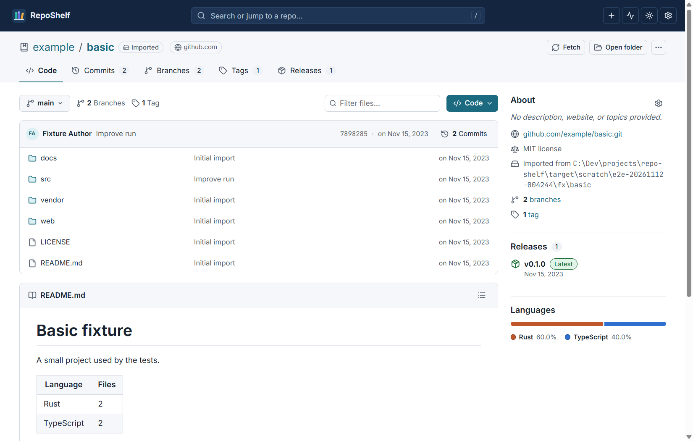
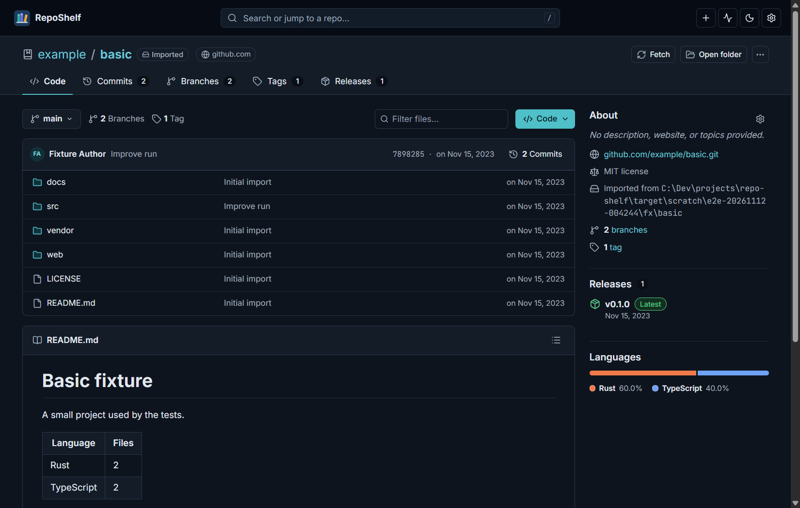
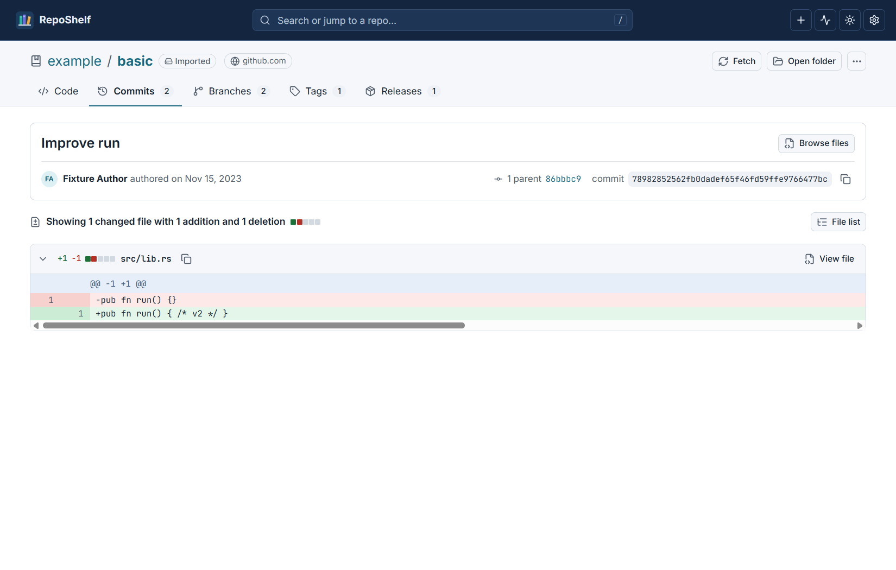
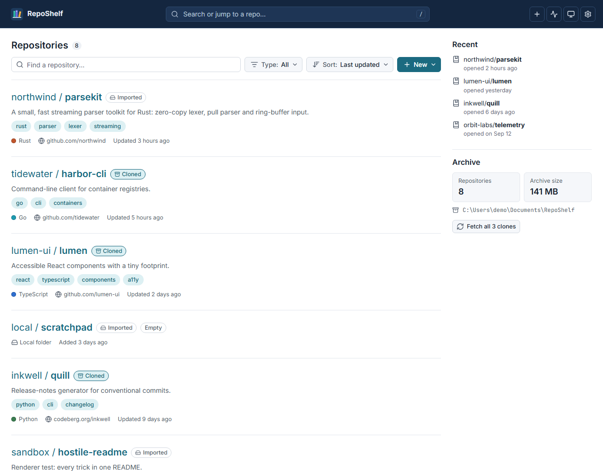

# RepoShelf

A desktop shelf for your git repositories that looks and feels like browsing github.com, but works offline from
your own disk. Import repositories you already have, or clone public `https://` repositories into an archive folder,
then browse code, commits, branches, tags and releases in a GitHub-style layout. Everything is read-only: RepoShelf
never writes into an imported repository.

Version **0.1.0** (Windows first; Tauri 2 + Rust + React 19 + TypeScript + Vite). Own name, own icon, own app id
`dev.schwi.reposhelf`; all CSS and layout written from scratch (lucide icons).



| | |
|---|---|
|  |  |
|  |  |

## What it does

| Screen | What you get |
|---|---|
| Header (all screens) | Logo / home, "Search or jump to a repo…" (`/`), "+" (Import folder…, Clone URL…), jobs popover with progress, Cancel, Retry, theme toggle (System / Light / Dark), settings |
| Dashboard | Repository list with filter, sort, source filter (Imported / Cloned), language dot, topics, "Updated …"; Recent (last 5 opened); archive size and count; Fetch all clones |
| Repo header | `owner / name`, source badge, Fetch (clones and https-origin imports), Open folder, Remove; tabs Code · Commits · Branches · Tags · Releases with counts |
| Code tab | Branch/tag switcher, file table with last-commit message and date per entry (loaded lazily), rendered README (sanitised), About sidebar (description, topics, homepage, origin — editable, stored in the app DB), language bar, latest-commit strip, commit count |
| File view | Breadcrumbs, syntax highlighting (in a worker) with line numbers, raw view, Markdown rendering, images (SVG only as ``), binary / large / LFS-pointer placeholders, Save as… |
| Commits / Commit | Paged history per branch (optional path filter), commit page with a unified diff per file, merge commits with parent switch |
| Branches / Tags / Releases | Ahead / behind compared with the checked-out (HEAD) branch, tags with dates, releases from tags + annotated messages; optional GitHub release notes for github.com origins (one request, on demand) |
| Settings | Theme, data and archive folders (Open), cache size + Clear cache, version |

Clones are bare (`<archive>\<host>\<owner>\<name>.git`), use Windows-safe handling (refs and paths Windows cannot store are
skipped and reported), run in the background with progress, and can be cancelled. Removing a cloned repo moves its
folder to the Recycle Bin; removing an imported repo only takes it off the shelf.

## Download / run

- Installer (per user, no admin): `RepoShelf_0.1.0_x64-setup.exe` — installs to your user profile, adds a Start menu
  entry and an uninstaller in Settings → Apps.
- Portable: `RepoShelf_0.1.0_x64-portable.exe` — one exe, nothing installed. It uses the same data folders as the
  installed app (below).

Both are built from this repo (see Build) and copied with `SHA256SUMS.txt` into `_REVIVE\releases\v0.1.0\`. They are
unsigned: Windows SmartScreen asks once (More info → Run anyway). Needs the WebView2 runtime (part of Windows 11).

## Data locations

| What | Default | Override (env var) |
|---|---|---|
| App data: database `reposhelf.db` (library, metadata, caches, settings, jobs) and the WebView profile | `%LOCALAPPDATA%\dev.schwi.reposhelf` | `RS_DATA_DIR` |
| Archive: bare clones made by RepoShelf | `Documents\RepoShelf` | `RS_ARCHIVE_DIR` |

Imported repositories stay where they are and are only read. With `RS_DATA_DIR` set, the WebView profile goes to
`%RS_DATA_DIR%\webview`, so a scratch run shares nothing with your real shelf. Example (PowerShell):

```powershell
$env:RS_DATA_DIR = 'C:\Temp\rs-try\data'; $env:RS_ARCHIVE_DIR = 'C:\Temp\rs-try\archive'
& .\RepoShelf_0.1.0_x64-portable.exe
```

The app makes no network requests while you browse. Only Clone, Fetch and the optional "GitHub release notes" button
go online.

## Develop

Needs Node 24 + npm, Rust (stable, edition 2024) and the Tauri 2 prerequisites for Windows (WebView2, MSVC build
tools). In a fresh PowerShell window refresh the process PATH first (see `docs/TESTING.md`).

```powershell
npm install                 # repo-local only
npm run dev                 # UI with the mock backend at http://localhost:1450/ (no Rust needed)
npx tauri dev               # the real app against your real data folders - set RS_DATA_DIR / RS_ARCHIVE_DIR to try it on scratch folders
```

Mock preview: in a plain browser the UI loads an invented mock backend (`src/ipc/mock/`). Switches go before the `#`:
`?empty`, `?slow`, `?huge`, `?clonefail`, `?fetchfail` (e.g. `http://localhost:1450/?huge#/northwind/parsekit`). Launch
config `reposhelf-mock` in `.claude/launch.json`.

Layout: `crates/rs-core` (git read model, library, clone/fetch, caches; no Tauri), `crates/rs-cli` (`rs fixtures`,
`rs bench`), `src-tauri` (IPC commands, window, OS seams), `src/` (React UI), `tools/` (portable build, e2e harness,
mock screenshot list). Design docs in `docs/`.

## Test

```powershell
cargo test --workspace --all-features
cargo clippy --workspace --all-targets -- -D warnings
npm run typecheck
npm test
cargo run -p rs-cli --release -- fixtures target\scratch\bench; cargo run -p rs-cli --release -- bench target\scratch\bench
```

Real-app end-to-end run (separate e2e build with test seams; scratch folders only; window off-screen):

```powershell
npm run build
$env:CARGO_TARGET_DIR = (Join-Path (Get-Location) 'target\e2e'); npx tauri build --no-bundle --features e2e; Remove-Item Env:CARGO_TARGET_DIR
powershell -ExecutionPolicy Bypass -File tools\e2e\run-e2e.ps1     # -Network adds two public clones (opt-in)
```

Details, every gate command and the hand-test checklist: `docs/TESTING.md`.

## Build a release

```powershell
npm run build:installer     # target\release\bundle\nsis\RepoShelf_<ver>_x64-setup.exe (Tauri's NSIS bundler, currentUser)
npm run build:portable      # target\release\portable\RepoShelf_<ver>_x64-portable.exe
```

Shipped builds go through the Tauri CLI only, never with `--features e2e` and never with `cargo build --workspace`
(that would compile the test kit in); `build:portable` refuses an exe that contains a test-seam name
(`RS_TEST_FILE_CLONE`, `RS_E2E_`). Keep `build.assetsInlineLimit: 0` in `vite.config.ts` (the CSP blocks `data:` fonts).
The version lives in `package.json`, `Cargo.toml` (`workspace.package.version`) and `src-tauri/tauri.conf.json`.

## Assumptions (fixed for v0.1)

1. "From scratch" = a new codebase, not a fork of Project Manager (read only for lessons).
2. "Resembles GitHub" = the layout and arrangement of github.com; own name, icon and app id, no GitHub logo, Primer
   CSS or copied assets.
3. Stack: Tauri 2 + Rust (git2 0.21, vendored libgit2) + React 19 + TypeScript + Vite, npm. Windows first, code stays
   cross-platform.
4. Scope: a github.com-style browser over a local archive — dashboard, Code tab, file view, commits + commit diff,
   branches, tags, releases, import a local folder or clone a public https URL, fetch a clone, editable local metadata
   (description, topics, homepage), light + dark theme.
5. Deferred: issues, pull requests, Actions, wikis, projects, stars/social, sign-in/auth, pushing, editing files,
   private-repo cloning.

## Not in v0.1 (out of scope)

Issues, pull requests, Actions, wikis, projects, discussions, stars / watch / fork, sign-in / auth / tokens, private
repo cloning, ssh, pushing, committing, editing files, checkout / switching working trees of imported repos, blame,
code search across files, split diff, compare between arbitrary refs, zip / tarball download, LFS fetch, submodule
recursion, GitHub API beyond the optional release-notes fetch, auto-update, multi-user, sync between machines.

## Planned: Explore mode (M10, not built)

A planned feature only, not part of 0.1.0: type `owner/repo` and the same screens fill from GitHub's public API
(read-only), with "Save to shelf" to start the normal clone, and an optional repository search. Open points before it
is built: the unauthenticated rate limit (cache responses; an optional token would need OS keychain storage), and
widening the CSP and the Rust HTTP allow-list to `api.github.com` only, so the app stays offline unless Explore is used.
Plan: `docs/TASKS.md` → M10.

## Known limits

- No real SVG/HTML execution: READMEs are sanitised, remote images become chips, links to other sites ask first.
- Very long histories: the commits list walks up to 20,000 commits per scan ("Search older commits" continues).
- The network-adapter-off run, the `-Network` e2e run and the other hand tests in `docs/TESTING.md` §5 are still to be
  done by a person.

## Docs

`docs/REQUIREMENTS.md` (what and why), `docs/ARCHITECTURE.md` (design), `docs/TASKS.md` (milestones M0–M10 and gates),
`docs/DECISIONS.md` (D-1…), `docs/WORKLOG.md` (what was done per milestone), `docs/TESTING.md` (tests, e2e, hand tests).

License: MIT.
